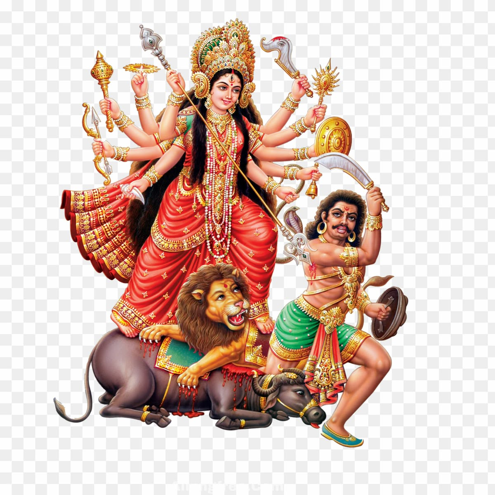
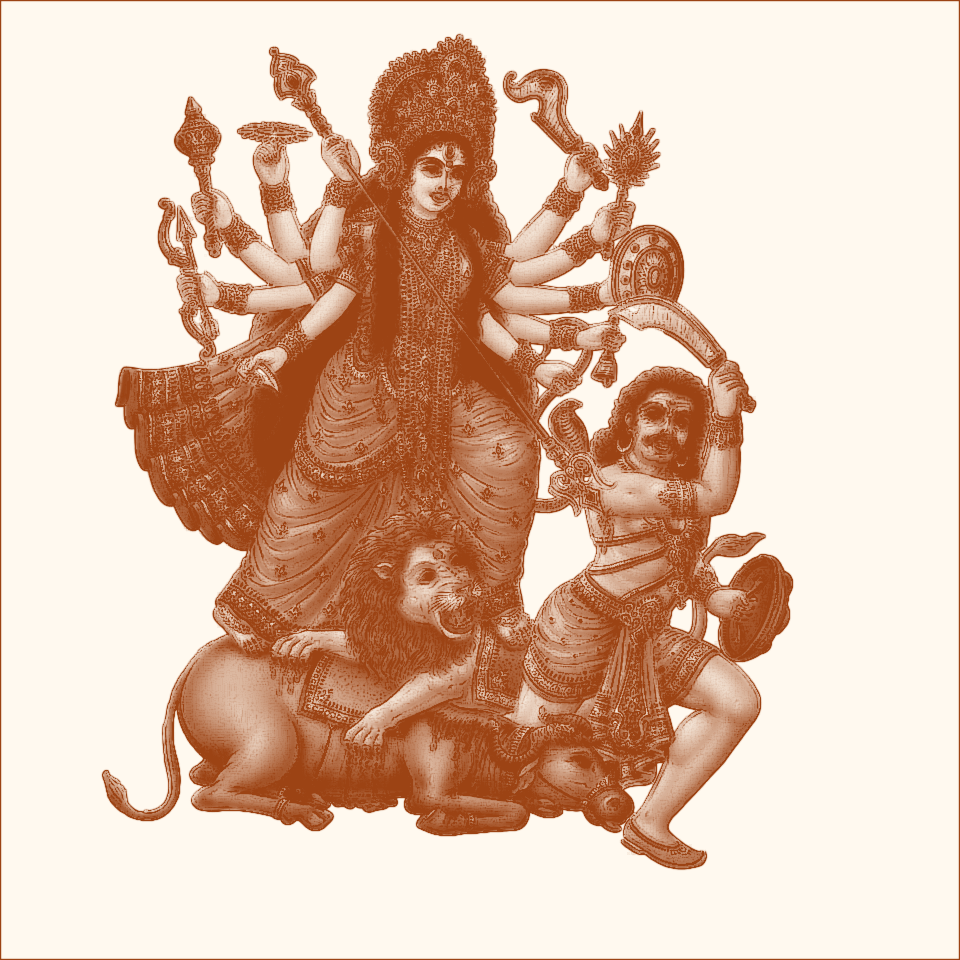

# Maa Durga Gerua Sketch

Animated gerua (red-ochre) pencil sketch of `image.png`, revealed stroke-by-stroke in a Pygame window.

Input `image.png` → output `durga_gerua_sketch.png` + live drawing animation in `draw_goddess.py:1`.




## Requirements

- Python 3.10+
- `pygame`
- `pillow`

## Install

```bash
python3 -m pip install pygame pillow
```

## Run

```bash
python3 draw_goddess.py
```

Place `image.png` next to the script. Output is saved to `durga_gerua_sketch.png` on every run (`draw_goddess.py:56`).

## Controls

| Key | Action |
|-----|--------|
| `Space` | Pause / resume |
| `R` | Restart reveal |
| `Esc` | Close window |
| Window X | Close window |

Progress (`Drawing N%` / `Paused`) is shown at the bottom of the window.

## How it works

1. Load `image.png`, thumbnail to 960×960 (`draw_goddess.py:23`).
2. Replace pale neutral checker background (`RGB > 224`, spread < 15) with paper `(250, 247, 238)` (`draw_goddess.py:31`).
3. Grayscale + autocontrast (`draw_goddess.py:37`).
4. `FIND_EDGES` + blur → `edge_ink`, subtract from gray for line detail (`draw_goddess.py:40`).
5. `colorize(black="#9C4314", white="#FFF9EF")` for gerua ink on paper (`draw_goddess.py:43`).
6. Pygame reveals rows top-to-bottom at `DRAW_SPEED`, with pen cursor and scaled sheet (`draw_goddess.py:79`).

## Configuration

Edit top of `draw_goddess.py`:

```python
WINDOW_SIZE = (900, 900)  # initial window, resizable
PAPER = (250, 247, 238)   # canvas/paper color
GERUA = "#9C4314"         # sketch ink color
DRAW_SPEED = 18           # rows per second
```

## Files

```text
p/
├── draw_goddess.py          # sketch + animation
├── image.png                # source image (required)
├── durga_gerua_sketch.png   # generated output
└── README.md                # this file
```

## Troubleshooting

- `FileNotFoundError: Put image.png next to this script` → `image.png` missing from project root.
- Blank / slow window → install pygame correctly, close other pygame windows.
- Colors look washed out → check source contrast; `ImageOps.autocontrast(cutoff=1)` assumes a photo with shadows.
